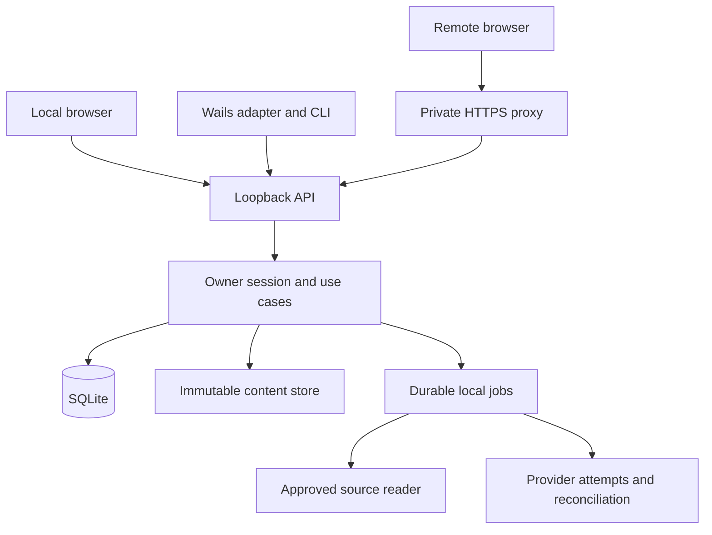

# Architecture

**Source:** Revision 4, Section 3, as amended by owner decisions D-08 and D-09 for personal developer use and directory results. **Elaboration:** proposed component boundaries and implementation layout, pending G-CONTRACT.

## Context and process boundary



The shared UI and both access paths belong to one Go daemon and library. Proposed local HTTP is `127.0.0.1:9270`; optional private HTTPS forwards to that same listener. The port is configurable and remote access starts disabled. A remembered per-device bearer identifies the owner for both browser paths; loopback and forwarded headers do not grant authority. The proxy is deployment infrastructure. One listener does not imply one browser origin: the evidence-selected renderer construction must also preserve independent version content roots. Its endpoint-specific origins/context, site relationships and mapping are selected and recorded in G-VIEW before G-CONTRACT; a second API service, wildcard domain or certificate setup is not a prerequisite by itself. Wails' bridge is confined to its trusted adapter and is not the public daemon protocol.

## Proposed repository layout

```text
haeryong/
  go.mod                      # Headless module only
  cmd/haeryong/               # CLI and daemon mode
  internal/domain/            # IDs, states, invariant validation
  internal/application/       # Use cases and ports
  internal/adapters/http/     # API, sessions, web assets, SSE
  internal/adapters/sqlite/   # Repositories and migrations
  internal/adapters/content/  # Staging, immutable storage, GC
  internal/adapters/source/   # Approved reference/snapshot reads
  internal/adapters/ai/       # Provider transport and capability gates
  internal/jobs/              # Durable coordinator, not a general engine
  internal/security/          # Device pairing, sessions, API authorization
  internal/webassets/         # Compiled shared web output
  desktop/                    # Separate Go module; Wails imports stay here
  frontend/                   # React/TS proposal, web/native transport adapters
  skills/use-haeryong/        # Haeryong-owned skill and contract references
  tests/fixtures/             # Small synthetic two-project corpus
  docs/                       # This execution specification
```

The names are proposed targets, not an inspected repository. Enforce import direction with a build check: domain/application cannot import Wails, HTTP handlers, provider SDKs or SQLite. Use ports for clock, source reader, AI execution, content store, authorization and repositories. Avoid a service locator or universal plugin bus.

## Single writer and process lifecycle

A profile owns a canonical data directory, lock, `library_id`, instance ID and endpoint discovery record. Acquire an OS-backed lock before opening write-capable DB access. PID files alone do not prove exclusive ownership. An endpoint matching a port is not sufficient identity; authenticated clients verify library/profile/API identity.

The daemon validates and creates the configured listener, verifies migrations and recovery state, then advertises readiness for the authenticated library. Startup failure leaves a clear local error and does not choose another port or initialize another library. Signal-based stop drains short writes, checkpoints coordinator state and closes listeners. External requests still in an unknown state remain unknown. Desktop close/quit never invokes Stop service implicitly.

Use one short-lived write path and bounded read connections. All transactions must complete before waiting for a provider or user approval. A validated result is applied with current resource revisions, policy restrictions, permissions and lifecycle state rechecked. Package imports verify staged bytes, flush files, atomically publish immutable paths, flush containing directories as supported by the validated platform, and only then commit the referencing database transaction durably. A flush/publication failure cannot return success. The exact SQLite settings, filesystem and recovery behavior require G-STACK and fault evidence; writing or renaming alone is not a durability proof. Abandoned files are recoverable garbage, not visible half-documents. Read/render verification must cover the same bytes subsequently consumed.

## One product, two clients

Shared frontend components depend on an `HaeryongClient` interface. The browser implementation calls `/api/v1` and consumes `/api/v1/events`; local and remote API/events use a header-capable bearer transport. Downloads and renderer resources use each endpoint's tested delivery construction under the normative [content delivery authority](contracts/authentication.md#content-delivery-authority). The trusted browser origin remembers its device token by default and reloads confirmed session state without pairing again. User/browser storage loss and optional memory-only mode have a visible reconnect/re-pair path; ordinary restart and actual storage loss are separate cases. The native implementation calls the same domain contracts through a narrow desktop Go proxy. Record its actual trusted document origin, API path and credential storage in G-STACK/G-VIEW; a different native origin does not automatically require new browser CORS grants. Wails imports cannot appear in shared UI/domain modules. The proxy cannot accept arbitrary URLs, filesystem paths or generic method names from imported content.

Trusted UI assets are compiled into the Go distribution. No development server is needed in production. API and UI use the same origin where practical, while imported explanations use the separate isolation boundary described in [viewer protocol](contracts/viewer-protocol.md). Native OS dialogs, service installation and process start remain local operations. An already paired owner may edit supported connection/source settings with the ordinary impact confirmation; external network enrollment and an OS file picker remain host operations.

## Foundation ownership and durable operations

EPIC-002 supplies the minimal durable local job store, operation receipts, mutation revisions, transactional outbox and object pins used by import, lifecycle, backup and event delivery. EPIC-005 builds its backup/export work on that foundation. EPIC-006 adds provider attempt dispatch, supported recovery and uncertain-outcome reconciliation; it does not introduce a foundation that earlier Epics already needed.

An operation receipt is keyed by principal and operation ID. A request fingerprint includes method, canonical target/route, body and meaningful original preconditions. After current authentication and permission checks, replay/reconcile an existing receipt before testing the original mutation precondition again. Same-ID retries cannot create a second committed mutation. Unknown provider outcome is distinct from a confirmed safe-to-retry failure. Cancel intent is monotonic: observing an old outcome cannot authorize redispatch or result application. A new requested action uses a linked job where cancellation has already fenced the old one.

Each job or active read holds pins for the immutable objects it consumes until completion or reconciliation. Captured source identities/digests do not retain bytes by themselves; a source read set records which approved bytes are available or retained. GC accounts for active reads, publication staging, drafts and backup/export snapshots as well as published versions. Provider results also require an active-attempt ID and generation fence so late results from an earlier attempt cannot apply during the same daemon run.

Events carry a stream epoch and sequence plus typed invalidation/revision information. A supported restore changes the stream/auth epoch even while preserving logical library identity. A client whose cursor cannot be replayed refetches authorized state. Lifecycle and permission changes also invalidate a resource already on screen without disclosing newly hidden content.

EPIC-004 adds a minimal approved source reader for exact revision resolution and cheap change observation. Its coverage is explicit, and it does not assert semantic freshness. EPIC-006 extends that reader with provider-facing source integration and remembered disclosure settings; EPIC-008 owns semantic maintenance. A broker is an implementation option, not a mandatory replacement for the owner's normal provider tools. Attempt input observations identify exact daemon-supplied bytes or bytes confirmed by real native-tool telemetry. A later source check can produce posthoc_verified target evidence without pretending it observed the provider's original input. Acquisition, semantic support, coverage and present byte availability remain distinct. Shared state names, identity scopes and routes are defined in the [schema registry](contracts/schema-registry.md).

## Persistent state partitions

| Partition | Owner | Mutable? |
| --- | --- | --- |
| Original package, source basis, authored links | Document version | No after publication |
| Topics, later relationships, freshness findings | Management service | Audited revisions; no original rewrite |
| Notes, review, revisit, preferred default page, last-opened pointer and page positions | Owner | Separate resources and validators; no original rewrite |
| Lifecycle/tombstone | Lifecycle service | Only authorized transitions |
| Jobs, receipts, proposals, audit | Coordinator/application | Durable state machine |
| Browser/native credentials | Auth service | Revocable; not package content; invalidated on restore |
| Raw source access | Configured source reader | Exact reads within remembered project/disclosure settings |

## Main operations

### Publish a requested explanation

Search eligible library context and resolve source evidence when the task needs source-grounded claims. Generate one output directory with any number of pages and supporting files, or select an existing directory/ZIP. Authoring does not require manual service IDs, a manifest, digests, a special region vocabulary or index.html. The service inventories and hashes the selected tree incrementally, records optional metadata separately and publishes one complete immutable directory version through an idempotent import. Missing source metadata yields an unknown/unverified basis without blocking the import. Explicit target choices override a remembered workflow association; otherwise the client resolves a new document in the selected or stable Unfiled project. A deliberate new-document request overrides a remembered document. Invalid explicit or stale targets never silently fall back to new-document creation. An explicit request to create and import carries publication authorization for that scope; maintenance drafts use their ordinary Publish action.

Directory traversal, resumable transfer and hashing use durable staging and file/object rows instead of a whole in-memory manifest. A changing input file must be detected or read from a stable captured object; do not publish a digest computed from different bytes. Final visibility commits only after the captured inventory and durable object references are complete. A new version need not duplicate unchanged blobs, while its snapshot still identifies every selected path.

### Inspect and ask

Authenticate, resolve the exact document/version/page and check lifecycle. A small render bootstrap and cursor-based file listing identify the result; fetch only the selected page and requested dependencies through path-preserving, streamed file access. The original directory never has to fit a JSON envelope or be inlined into one HTML. Normal relative and root-relative URLs, query/fragment navigation, history, modules and workers must work in the chosen renderer construction. Its origin remains separate from the trusted host.

Page identity is (version_id, page_path); region identity also includes region_id. An in-version symlink resolves to that actual HTML entry, with an optional navigation_path retaining the authored alias. Explicit page links win; Continue uses the last-opened pointer, while an open-without-page action uses the owner's preferred default before the immutable package default and normal index/sole-page/list fallback. Each page's position and the version pointer have independent validators. On a page change, replace its renderer channel and reject late messages from the old page while preserving result navigation and personal state. Large JSON/text selection context uses the [viewer transfer protocol](contracts/viewer-protocol.md#large-context-transfer-messages), bounded-memory incremental staging and an opaque context_ref. An already materialized transferable buffer may use an evidence-selected fast path; the frame channel has temporary flow control, while HTTP upload status owns durable resume/checkpoints. Save/Ask adopts its exact bytes and pins in the accepted mutation, so later channel disposal or cleanup cannot erase saved context. Context messages do not start AI work or mutate library state. An explicit question captures the chosen page/scenario and permitted pinned/current source targets before provider work; missing source remains explicit.

### Maintain

Create an immutable scan inventory, perform deterministic structure checks, retrieve bounded candidate sets, compare approved source targets, save findings, then apply only policy-authorized overlays with preconditions. Changes to published text create draft proposals. UI reports actual coverage and unresolved items. Region-free HTML is assessed at page or version scope; a directory with no HTML can have a version unit. Missing targets, unknown eligibility or zero eligible units never imply alignment. Default target display uses remembered project source mode and an applicable already-captured target set, without launching reads or AI merely to render a list.

### Export and resource behavior

Export the selected immutable tree as files or a streamed archive while keeping exact file bytes and paths. Additional Haeryong metadata is opt-in and separate. Every selected file remains included regardless of extension or hidden-name convention; an unavailable preview has a listing/download fallback. Preserve represented empty directories and link records, report actual destination representation conflicts, and never resolve an outside-directory link by silently copying unrelated source material.

No Haeryong product cap applies to HTML bytes, total compressed/expanded bytes, file count or directory depth. Pagination, stream chunking, verification buffers and worker concurrency are internal capacity controls. Imports/exports expose actual progress and cancellation/resume, and do not claim success on disk-full, I/O failure or incomplete transfers. An individual page may still exceed a device's real rendering capacity; keep the result intact and offer reload/download or another supported device. Never turn measured benchmark sizes into admission limits.

## Architecture risks and gates

The viewer runs the owner's chosen HTML/CSS/JavaScript with normal browser capabilities, including external resources. Use one html_js_v1 profile; no custom declarative runtime or JavaScript API allowlist is required. Keep its execution origin and native access separate from the trusted application. Before G-CONTRACT, the complete [TASK-001-04 checklist](tasks/EPIC-001/TASK-001-04.md#observable-completion-and-tests) is the single authority for G-VIEW's required environments and closing evidence, including concurrent versions with distinct bytes at identical root-relative fetch/module/worker paths. The [focused procedure](contracts/viewer-protocol.md#focused-g-view-evidence) also checks multi-page/new-tab navigation, authored worker replacement and origin reuse, storage/restart/foreground behavior, host-token/DOM separation, rejected management messages and the selected Wails bridge boundary; it does not demand universal egress or CPU containment. Broken pages need visible errors and reload/close where responsive, with app-restart recovery if the rendering context is blocked. The daemon's saved data and accepted work survive. G-VALUE checks whether explanations and interaction help on real source.

The complete [TASK-001-05 checklist](tasks/EPIC-001/TASK-001-05.md#observable-completion-and-tests) is the G-AI closing authority: one supported real subscription path, a real cited question, actual input/verification evidence, remembered permissions and honest error/cancel/uncertainty behavior. Multi-page generation and usefulness belong to TASK-001-07; durable production provider recovery belongs to EPIC-006. Existing external agents retain their normal workflow. No mandatory worker-jail platform is added, and ambiguous external outcomes are not evidence that reruns are free or exactly once.

See [security](operations/security.md), [ADRs](adr/README.md), and [roadmap](roadmap.md) for mitigation ownership and blocking gates.
