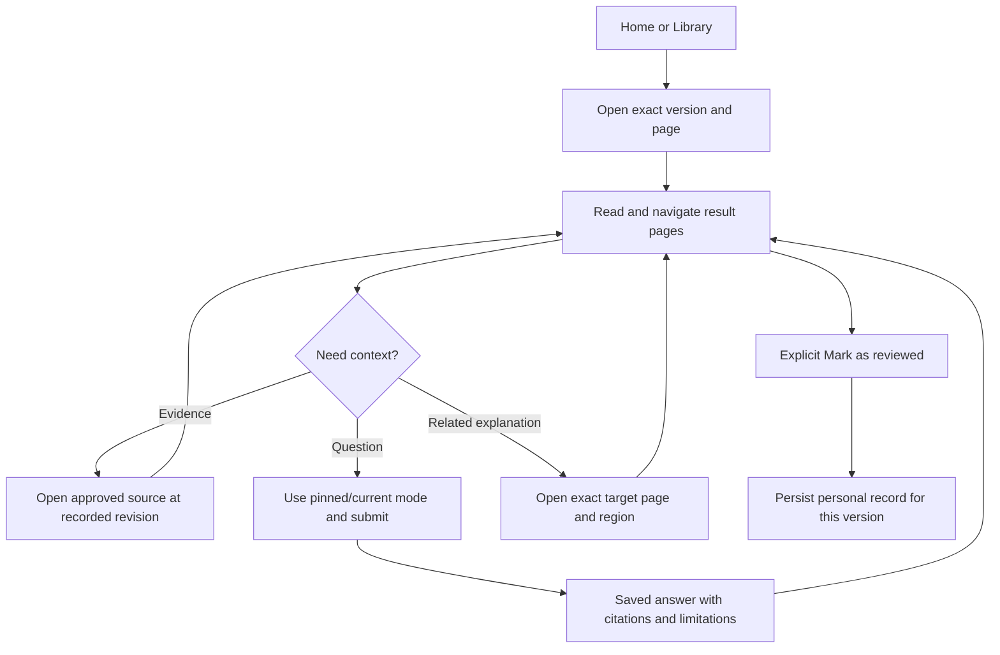
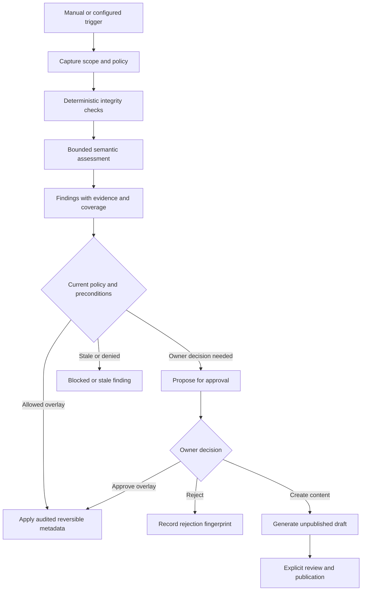

# Product interaction flows

The [R5 interactive concept](../design/prototype/README.md) and its [UI handoff](../design/prototype/HANDOFF.md) provide current UI baseline inputs for walking these flows. The handoff distinguishes sample interactions and reviewed states from the production behavior specified below.

## Connect once and resume

A new browser shows a comparison code and Remember this device, selected by default. An approved owner can reject that exact request; Stop waiting only ends local polling and discards the pending secret, leaving server expiry/rejection semantics explicit. Approve the exact request from local bootstrap or an existing owner device. Subsequent reloads, tabs and browser restarts reuse the stored credential and open the original version/page/query/fragment/region after a session check. A revoked, optionally expired or restore-invalidated session reconnects explicitly. Temporary mode omits persistence. Routine reading, JavaScript execution and already configured source/provider use do not prompt again.

## Import and open a result directory

Choose New document (default) or Existing document, new version, then select the AI's output folder, ZIP or single HTML. Reader/Versions preselect the exact document; the shared [import controls](screens.md#import-export-and-file-operations) capture and display its base before upload and retain both target/base for the same retry. A name/path/hash never silently binds a document. The service enumerates represented selected entries, transfers/hash-verifies bytes incrementally and persists resumable staging. No author manifest, manual IDs/digests, region declarations or source metadata are required. The UI shows actual files/bytes and an unknown total while enumeration is incomplete, then one complete published directory version. Cancellation or I/O failure never publishes a partial result. A FileList picker cannot report empty directories; state selected-entry fidelity and offer an entry-aware/native/CLI or ZIP route with directory entries for whole-tree preservation. Lost upload IDs are recoverable from Settings/Storage's owner upload list, with actual progress, target, state and explicit Resume/Abandon.

An explicit page link opens that target; Continue resumes the separate last-opened pointer. Otherwise use a valid owner preferred default, immutable supplied default, root index.html or the sole HTML; if none applies show Files/Pages. Choose any page, follow ordinary local links and use Back/Forward inside that same version. Large folders use paginated navigation and on-demand file loading. Unsupported preview types remain downloadable. Download original streams the selected original paths/bytes through the shared browser/Wails action. Selected personal records and separately retained sources use the labelled host-local CLI portability export; the ordinary download is not a full backup.

## Read, verify and review

Local page navigation stays in the selected directory version. An authored link to another result opens its exact target version/page and preserves the return path. Page open, cross-page navigation and diagram clicks never imply review completion. Explicit Mark as reviewed can complete an Unreviewed or Reviewing version; Reopen/Clear updates current personal state and retains history. Navigating to a new version leaves the historical record intact and the new version Unreviewed. Revisit applies independently to the document. A missing source or unknown source basis is visible and does not block reading the saved explanation. From Evidence, Check source evidence performs the later authorized exact-source verification once TASK-004-01 is available; original evidence remains immutable and check outcome/history is a separate overlay. This action does not require AI or make verification an import condition. Notes/questions capture the selected page, optional region and actual scenario. Large context transfers automatically without author field/byte caps; an owner Ask/Save action remains explicit.

## Maintenance proposal lifecycle

A finding cannot directly modify original HTML, mark Reviewed, expand source access or delete outdated documents. Create draft dispatches the explicit finding-bound generation request; Request reassessment starts the finding-bound scoped scan. Draft rejection fences linked application, and replacing a ready draft's files creates a new draft revision with its captured base/history preserved. Neither replacement nor overlay approval publishes it; publication remains a separate current-revision action.

## Reader preferences and position

Set as preferred default edits the owner preference for the exact directory version. It does not change the immutable package default or last-opened pointer. Open/navigation records the version pointer; scrolling records only that page's query/fragment/position with its own ETag. Reopening a different page reads that page's record. Two pages with independent position changes do not conflict through a shared scroll field; concurrent edits to the same page record still use normal revision conflict handling.

## Multi-device conflict

Device A reads note revision 3. Device B updates it to revision 4. A's Save with If-Match 3 receives 412 and current revision metadata. The local unsaved text remains visible for comparison; the UI offers reload or deliberate merged edit against revision 4. It does not silently overwrite B or invent a successful save. If an acknowledgement was lost, reconnect authenticates and reconciles the existing operation ID first. The service returns an authorized stored outcome before reevaluating that operation's original If-Match, so a successful save is not misreported as a conflict. A genuinely new merged edit uses the current revision and a new operation ID.

## Destructive lifecycle

Request an impact plan, inspect eligible content and references, confirm the exact plan once as the owner, and commit only after the service rechecks lifecycle and revision. There is no separate administrative grant or elevation step. The UI updates after acknowledgement or receipt reconciliation. Lifecycle is document-level: restore returns a trashed document to its prior active or archived state, while purge is terminal for that identity. Restore and purge compete through the same preconditions. Auto purge uses explicitly confirmed policy and execution-time eligibility, not AI classification. Active source reads and backup/export jobs also protect their captured objects from garbage collection.

## Cross-device and restored-session refresh

Events invalidate visible review, lifecycle, Revisit, overlays, findings, drafts and assessment state by typed resource/revision. When a resource becomes hidden or access is revoked, clear its existing renderer/cache without transmitting the now-hidden body. A stream epoch mismatch after supported restore, an expired cursor or a cursor ahead of the current stream triggers authorized state resynchronization. Library identity stays stable, but old credentials and event cursors do not become valid again.

## UI review checklist

At each feature gate, exercise the delivered subset below and name the later owner of unavailable production features; repeat the full set at the applicable integrated gate. Before approving implementation, walk the wide/tablet/phone Reader with a multi-HTML directory, nested/Unicode paths, relative assets and local Back/Forward navigation, a large file listing, an attachment with download fallback, an export round-trip, a real JavaScript interaction, remembered reload/new-tab/restart, one source-unavailable example, one stale note conflict, a revoked session, an outdated-but-Reviewed document, a referenced trashed document, a partial semantic scan, and a retention change that does not enable purge. Confirm that every warning says what is known and what action is available without requiring a graph or CLI for ordinary reading.
